# AIHub——多租户通用 AI 能力中台

# 摘要

随着大模型技术进入规模化落地阶段，各类业务系统接入人工智能（AI）能力的需求爆发式增长，但中小企业与开发团队普遍面临模型绑定、重复造轮子、成本失控与安全合规四重困境。本作品面向这一现状，设计并实现了 AIHub——一个多租户的通用 AI 能力中台。平台自身不绑定任何垂直业务，而是将大模型能力（对话、检索增强生成、工具调用、智能体）抽象为可配置、可编排、可计量、可观测的平台能力，对外以开放 HTTP 接口与管理控制台两种形态交付，业务方通过配置一个"应用（助手）"即可组装出所需 AI 能力，实现"模型可换、知识可插、工具可注册、Agent 可编排、一切可按租户计量与审计"的设计目标。

平台后端采用 Java 17、Spring Boot 3.5、Spring Cloud 2025 与 Spring AI 1.1 构建微服务架构，前端采用 uni-app 与 Vue 3 实现一套代码同时交付 H5 与微信小程序双端。作品的核心创新点包括：（1）多租户安全隔离四道防线，将"租户优先"原则从口头约定升级为框架级强制；（2）一套前端适配三通道的流式交互体系，统一事件帧协议覆盖 SSE、NDJSON 与 WebSocket，并完成网关层流式透传调优，实现逐帧到达的打字机体验；（3）模型可插拔架构，新增模型供应商仅需新增一个实现类与一条数据库配置，支持场景选模与主备自动降级；（4）检索增强生成（RAG）全链路与 Agent 编排内核，配合模型上下文协议（MCP）双向集成，既能消费外部工具生态，也能把平台自身能力开放给第三方 AI 应用。

作品完成了六个里程碑的全部功能开发与端到端验证，模型网关、应用编排、知识库 RAG、工具中心、MCP 双向、Agent 编排、会话记忆、产物管理、安全护栏、可观测与成本、多租户与配额等核心能力域均已落地，提示词版本管理列为下一迭代，配套完成管理控制台、用量配额、审计日志与全链路可观测建设，具备从课堂作品走向生产环境的工程完整度。

关键词：AI 中台；多租户；检索增强生成（RAG）；智能体（Agent）；模型上下文协议（MCP）；流式交互

## 第一章 背景与创意

### 1.1 政策背景：人工智能上升为国家战略

人工智能是引领新一轮科技革命和产业变革的战略性技术。2017 年，国务院印发《新一代人工智能发展规划》，提出到 2030 年使我国成为世界主要人工智能创新中心的战略目标。2025 年 8 月，国务院进一步印发《关于深入实施"人工智能+"行动的意见》，部署"人工智能+"科学技术、产业发展、消费提质、民生福祉、治理能力、全球合作六大重点行动，并明确量化目标：到 2027 年，新一代智能终端、智能体等应用普及率超 70%；到 2030 年，应用普及率超 90%，智能经济成为我国经济发展的重要增长极。

产业侧的数据同样印证了这一趋势。据工业和信息化部在国务院新闻办公室发布会上介绍，2025 年我国人工智能企业数量超过 6000 家，核心产业规模预计突破 1.2 万亿元，智能算力规模达 1590 EFLOPS；据中国信息通信研究院测算，2024 年我国人工智能核心产业规模已突破 9000 亿元，同比增长 24%，呈加速增长态势。与此同时，我国生成式人工智能用户规模已超过 6 亿人。政策供给与产业增长的双轮驱动，意味着"人工智能+"正从概念走向千行百业的具体应用，而应用落地的第一道门槛，就是如何便捷、安全、低成本地把大模型能力接入业务系统。

### 1.2 行业痛点：AI 能力接入的"最后一公里"

在调研与开发实践中，我们观察到业务系统接入大模型能力普遍存在以下四类痛点。

其一，**模型绑定**。许多项目将特定厂商的软件开发工具包（SDK）或接口硬编码进业务代码，一旦需要更换模型供应商（成本、合规、效果变化均可能触发更换），就要付出高昂的改造成本。

其二，**重复造轮子**。对话流式输出、会话记忆、文档解析、向量检索、引用溯源等能力在各项目中高度同质，却往往每个团队都从零实现一遍，质量参差不齐。

其三，**成本失控**。大模型调用按令牌（Token）计费，缺乏统一的用量统计、配额管控与降级策略时，一次线上事故或一句恶意刷量就可能造成显著经济损失。

其四，**安全与合规风险**。多客户共用一套 AI 系统时，知识库串库、密钥明文落库、越权访问等隐患直接触及数据安全红线；而自研团队普遍缺乏系统性的隔离设计经验。

### 1.3 创意定位：让 AI 能力像水电一样即取即用

针对上述痛点，本作品提出"通用 AI 能力中台"的解决思路：将大模型相关的基础能力从业务系统中沉淀出来，建设一个独立的多租户平台，统一负责模型接入、知识管理、工具注册、智能体编排与计量计费。业务方不再直接对接模型厂商，而是作为平台的消费者，通过配置一个"应用（助手）"——指定系统提示词、模型、知识库、工具集与 Agent 策略——即可组装出所需的 AI 能力，如同用水用电一样即取即用。

一句话概括本作品的分层设计目标：**模型可换、知识可插、工具可注册、Agent 可编排、一切可按租户计量与审计。** 平台自身不绑定任何垂直业务，教育、政务、企业知识管理等场景均可通过配置接入，这正是作品通用性的立足点。

## 第二章 问题分析

### 2.1 现有接入路径的对比分析

围绕"业务系统如何获得大模型能力"，业界目前存在三类典型路径，各有明显局限，如表 2-1 所示。

表 2-1　三类接入路径对比

| 接入路径 | 优势 | 局限 |
| --- | --- | --- |
| 直连大模型厂商接口 | 起步快、无需自建 | 模型绑定；流式、记忆、检索等通用逻辑需重复实现；无租户与配额体系 |
| 项目内自建 AI 模块 | 与业务贴合、可深度定制 | 能力无法跨项目复用；安全与可观测建设成本高；每个项目都重复投入 |
| 采购封闭式 SaaS 产品 | 开箱即用 | 能力黑盒、难以定制；数据出境与私有化部署受限；按席位收费成本高 |

三类路径的共同缺陷在于：**缺少一个介于"模型厂商"与"业务系统"之间的能力沉淀层**。模型厂商提供的是通用算力与算法，业务系统需要的是开箱即用、可治理、可计量的场景化能力，两者之间存在明显的工程断层。

### 2.2 核心矛盾的拆解

进一步分析，AI 能力平台化需要同时调和三对矛盾。

**能力复用与业务定制的矛盾**。平台能力要通用，业务需求又千差万别。本作品的解法是"配置组合"——将应用定义为系统提示词、模型、知识库、工具集、Agent 策略、记忆策略等要素的配置组合，配置保存后即时生效，无需重启，也不改一行代码。

**开放接入与安全隔离的矛盾**。平台要支持多租户共享，租户之间的知识库与数据必须严格隔离。本作品的解法是"框架级强制"而非"人工约定"，详见第三章四道防线设计。

**成本控制与服务质量的矛盾**。模型调用昂贵且供应商可能故障。本作品的解法是"计量与降级"——按租户、用户、应用、周期四个维度原子扣减配额，主模型故障自动降级备用模型，降级事件全程留痕。

### 2.3 痛点与对策映射

四类行业痛点与本作品对策、对应能力的映射关系如表 2-2 所示。

表 2-2　痛点与对策映射表

| 行业痛点 | 本作品对策 | 对应能力 |
| --- | --- | --- |
| 模型绑定 | 统一 OpenAI 兼容协议族 + 场景路由，换模型零代码 | 模型网关 |
| 重复造轮子 | 流式、记忆、RAG、Agent 全部平台化沉淀 | 十二能力域 |
| 成本失控 | 四维配额硬限流 + Token 真实统计 + 用量看板 | 配额与可观测 |
| 安全合规 | 四道防线隔离 + 密钥加密存储 + 审计留痕 | 多租户与安全 |

## 第三章 技术方案

### 3.1 总体架构

平台采用"一个网关、两个业务服务、三个端"的微服务架构，总体架构如图 3-1 所示。网关（aihub-gateway，端口 8080）是全系统唯一入口，负责统一鉴权（JWT 与 API Key 双凭证）、限流熔断（Sentinel）与全链路追踪标识注入；平台服务（aihub-platform-service，端口 8081）承载认证注册、基于角色的访问控制（RBAC）、API Key 与用量配额；AI 服务（aihub-ai-service，端口 8082）将模型网关、对话、RAG、工具、Agent、会话与产物七类能力内聚为一个模块化单体，避免知识入库与流式输出跨服务拆分带来的复杂度。中间件层由 MySQL 8、Redis Stack（兼具缓存与向量检索）、Nacos（注册与配置中心）、Sentinel Dashboard、Prometheus 与 Grafana 组成，通过一条 docker compose 命令即可一键拉起。客户端形态上，平台提供管理端与用户端（H5 与微信小程序）三种端形态，技术栈选型如表 3-1 所示。

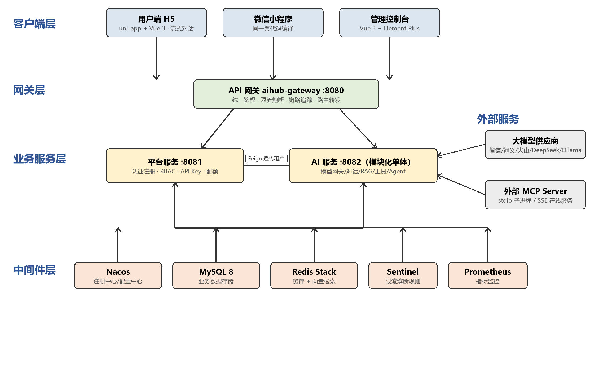

图 3-1　系统总体架构图

表 3-1　平台三端技术栈选型

| 端 | 技术栈 | 说明 |
| --- | --- | --- |
| 管理端 | Vue 3 + Element Plus + TypeScript | 模型管理、应用配置、知识库、用户角色、用量看板 |
| 用户端 H5 | uni-app + Vue 3 | 流式对话、知识库问答、Agent 任务 |
| 用户端小程序 | uni-app（同一套代码） | 与 H5 同源能力，微信开发者工具编译 |

服务内部遵循严格的四层架构：表现层（aihub-web）负责协议适配与三种流式出口；编排层（aihub-application）负责用例编排、事务边界与配额校验；领域层（aihub-domain）定义全部扩展点接口且零框架依赖；基础设施层（infra-ai、infra-persistence、infra-security）完成框架适配。分层依赖关系由 ArchUnit 规则固化，违反即构建失败，从机制上杜绝架构腐化。

### 3.2 创新点一：多租户安全隔离四道防线

多租户隔离是本作品安全设计的最高优先级。知识检索链路上落地了以下四道防线。

第一道，**入口收敛**。业务代码禁止直接注入向量存储（VectorStore），唯一检索入口是知识检索器（KnowledgeRetriever），从源头封堵绕过路径。

第二道，**强制注入**。向量存储提供者在每次检索时强制以"且"条件注入租户标识（tenant_id）过滤，调用方无法绕过、也无需感知。

第三道，**出口校验**。检索结果返回后，租户守卫（TenantGuard）逐条校验元数据中的租户标识，不匹配即丢弃并告警，实现"即使上游漏防，出口也绝不放行"。

第四道，**来源可信**。租户标识只从 JWT 或 API Key 解析，绝不接受前端传参——网关鉴权过滤器会强制剥离并覆盖客户端伪造的租户头；同时预留 MyBatis 拦截器兜底补全查询条件的能力。

四道防线中，前两道由代码显式实现，后两道构成纵深防御，并辅以跨租户自动化测试作为回归保障。向量索引层面，默认采用共享索引加租户标签字段过滤的方案，大租户可平滑切换独立索引；更换向量模型时通过"版本号索引 + 别名切换"实现零停机重建。

### 3.3 创新点二：三通道流式交互与网关调优

大模型输出天然是增量式的，流式体验直接决定产品观感。本作品将"流式"确立为一等公民：所有 AI 交互按流式设计，非流式只是流式的特例。平台设计了统一事件帧协议，以单一信封格式承载全部交互语义，事件类型定义如表 3-2 所示。

表 3-2　统一事件帧协议的事件类型

| 事件类型 | 含义 |
| --- | --- |
| msg.start | 消息开始，携带会话与消息标识 |
| token | 增量文本 |
| reasoning | 思考过程增量内容 |
| rag.sources | 检索到的引用来源 |
| agent.step | 智能体执行步骤（思考、行动、观察） |
| artifact | 产物生成完成，携带预览地址 |
| msg.end | 消息结束，携带 Token 用量与模型信息 |
| error | 错误，含错误码 |
| ping | 心跳保活 |

同一套事件帧协议适配三种传输通道：H5 端走服务端事件推送（SSE），前端用 fetch 加可读流解析（不采用 EventSource，因其无法携带自定义鉴权头）；微信小程序端走 NDJSON 分块传输，通过启用分块接收与手动维护缓冲区处理半包；Agent 长任务走 WebSocket 双向通道，支持随时中断。针对小程序分块传输，服务端强制关闭内容压缩（Content-Encoding: identity），避免分块被压缩后无法按行切分。

值得专门说明的是网关层调优实践：项目使用 Spring Cloud Gateway 4.3 作统一入口后，实测发现直连 AI 服务时流式逐帧到达，而经网关转发后整个响应被缓冲到最后一次性吐出，流式体验完全丧失。通过隔离环境复现与源码级排查，定位到根因：该版本网关的 Netty 响应写出过滤器仅对"流式媒体类型"列表内的响应执行逐帧冲刷，而 NDJSON 类型不在默认列表中。在配置中将 application/x-ndjson 补入流式媒体类型列表后，经网关的响应恢复逐帧到达。实测验证：一次典型问答共收到 103 个数据块，时间戳从首帧 67 毫秒起持续递增直到响应结束，思考过程帧间隔约 50 毫秒，与直连表现一致。这一排查过程本身也体现了作品"可实测、可归因"的工程方法论。

### 3.4 创新点三：模型可插拔与场景路由

平台将模型接入抽象为两个扩展点：模型解析器（ChatModelResolver）负责按供应商构建模型实例，支持 OpenAI 兼容、火山方舟、通义 DashScope、智谱、DeepSeek 与本地 Ollama 等供应商——它们同属 OpenAI 兼容协议族，差异仅在基础地址与模型名；选择策略（ModelSelectionStrategy）负责场景选模，聊天、检索、嵌入、Agent 规划四类场景可配置不同模型，兼顾效果与成本。新增一家供应商只需新增一个实现类与一条数据库配置，业务代码零改动。

模型实例与路由规则全部存于数据库，配置保存后即时生效、无需重启。供应商密钥采用 AES-GCM 算法加密落库，日志与接口返回值中永不出现明文。主模型调用失败时自动降级到备用模型，降级事件记入审计日志，保障服务可用性。

### 3.5 创新点四：RAG 全链路

知识增强覆盖从文档上传到引用溯源的完整链路。入库侧为异步任务流水线：文档解析（支持 TXT、Markdown、PDF、Word）→ 文本清洗 → 分片（段落与重叠窗口策略可配）→ 批量向量化 → 写入 Redis Stack 向量索引，元数据强制携带租户、知识库与文档三级标识；任务提供进度查询与失败重试，入库文件落本地磁盘，服务重启后仍可续传。检索侧实现责任链流水线：查询重写 → 向量召回 → 元数据过滤（强制租户与知识库条件）→ 出口租户校验 → 重排与相似度阈值过滤，命中分片以编号引用形式随回答返回，前端渲染为可点击的引用卡片，引用来源落库持久化，刷新页面后仍可查回。回答必须基于检索到的知识内容，未命中时按配置话术明确告知而非编造，从产品层面抑制幻觉。

### 3.6 创新点五：Agent 编排与 MCP 双向集成

智能体内核采用"同一内核、多策略"设计：规划型智能体（PlanningAgent）将用户目标拆解为子任务链，按名派发给表格、图表、网页文档等专用执行智能体，每个执行体内部运行"思考→行动→观察"（ReAct）循环，以固定的 done 动作终止。执行过程全程维护端上状态上下文，每个步骤通过事件帧实时推送至前端任务时间线。为防止失控，设置了三重预算（最大子任务数、最大 Token、最大超时），任一超限即终止并返回已得结果；用户点击停止后服务端真正取消后续步骤。智能体生成的表格、图表与网页落盘为产物（Artifact），支持在线预览与下载。

工具体系支持三类来源统一注册：本地注解工具、HTTP 工具与 MCP 工具。平台同时是 MCP 的客户端与服务端——作为客户端可配置连接多个外部 MCP 服务器（stdio 与 SSE 两种传输），外部工具自动挂载至对话；作为服务端，将平台自身的对话与知识检索能力经三个模块（业务实现、SSE 在线服务、stdio 进程服务）对外开放，同一套工具实现可同时以两种协议被 Claude Desktop、Cursor 等第三方 AI 应用发现和调用。

### 3.7 工程质量保障

平台内建了完整的可观测与治理体系：全链路追踪标识从网关起点生成，经服务间调用透传、日志上下文记录，直至响应体返回，一次请求可完整串起检索、工具与模型调用；Micrometer 指标覆盖每秒请求数、延迟、Token 消耗、工具调用与配额拒绝五类维度；审计切面在同步与流式双路径织入，完整记录调用者、应用、模型、Token 与耗时。配额体系支持请求数、Token、文档数、任务数四个维度，采用原子累加策略实现并发安全的硬限流。开放 API 通道面向第三方系统，API Key 仅存哈希摘要，网关校验结果缓存并采用失败关闭（fail-closed）策略。

## 第四章 功能展示

### 4.1 注册登录与多租户体系

用户端提供自助注册入口，注册即创建新租户并生成租户管理员账号，这是全系统唯一的建租户入口。登录环节采用图形验证码防暴力破解，签发的 JWT 携带租户与用户标识，后续所有请求经网关统一鉴权。如图 4-1 所示。

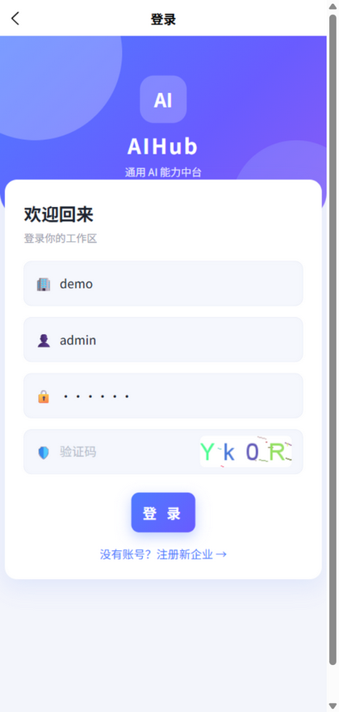

图 4-1　用户端登录页（图形验证码 + 租户码 + 账号密码）

### 4.2 H5 流式对话

对话页支持多会话管理与历史记录。提问后，回答以打字机效果逐帧呈现，模型思考过程以可折叠卡片实时滚动展示，正文开始输出后思考卡片自动收起；回答支持加粗、列表、代码等 Markdown 富文本渲染。如图 4-2、图 4-3、图 4-4 所示。

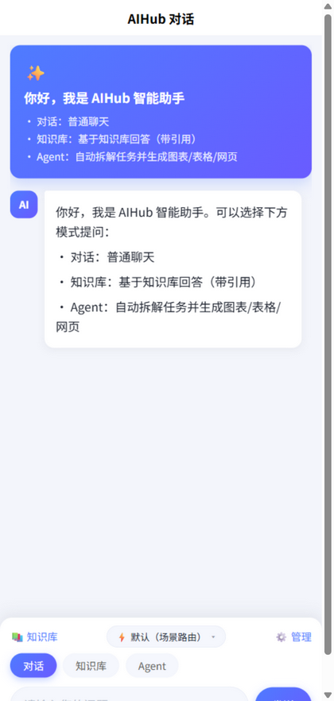

图 4-2　用户端对话首页

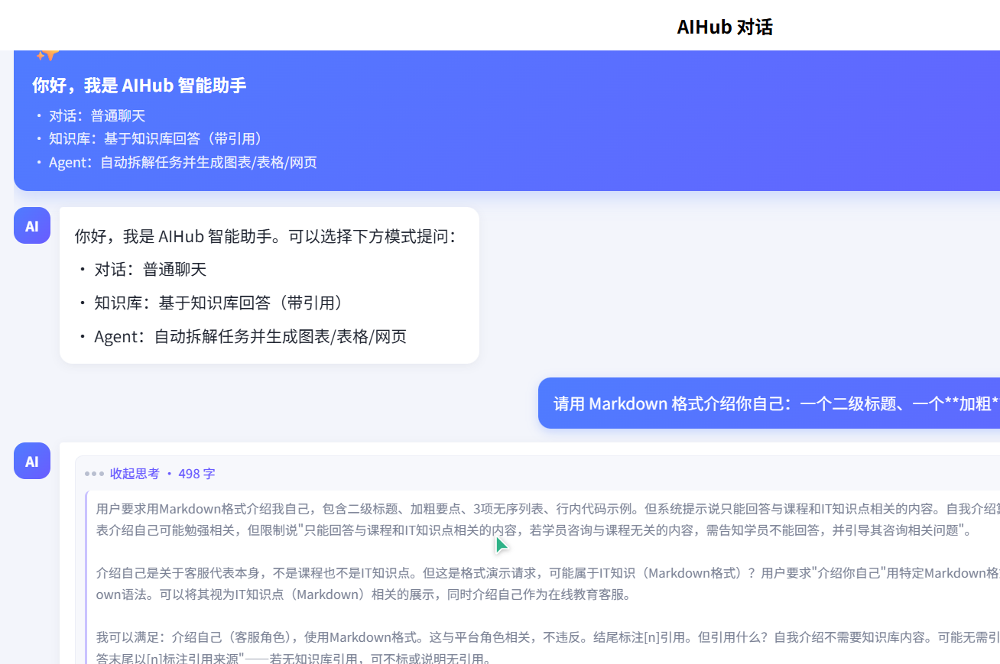

图 4-3　模型思考过程实时展示（可折叠卡片）

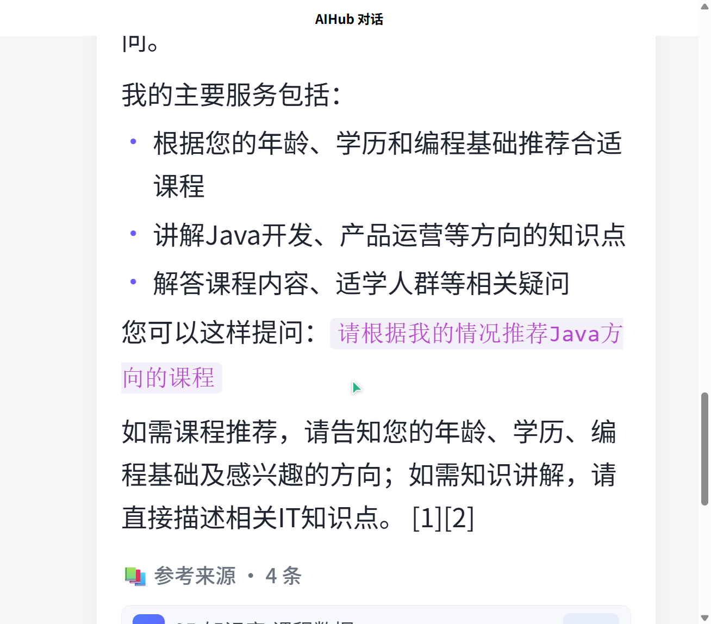

图 4-4　回答内容的 Markdown 富文本渲染

### 4.3 知识库问答与引用溯源

在绑定知识库的应用中提问，系统先检索命中分片再生成回答，正文以编号标注引用位置，下方展示引用卡片（含来源文档与相似度），点击可查看出处详情；引用来源持久化存储，会话刷新后仍可溯源。如图 4-5、图 4-6 所示。

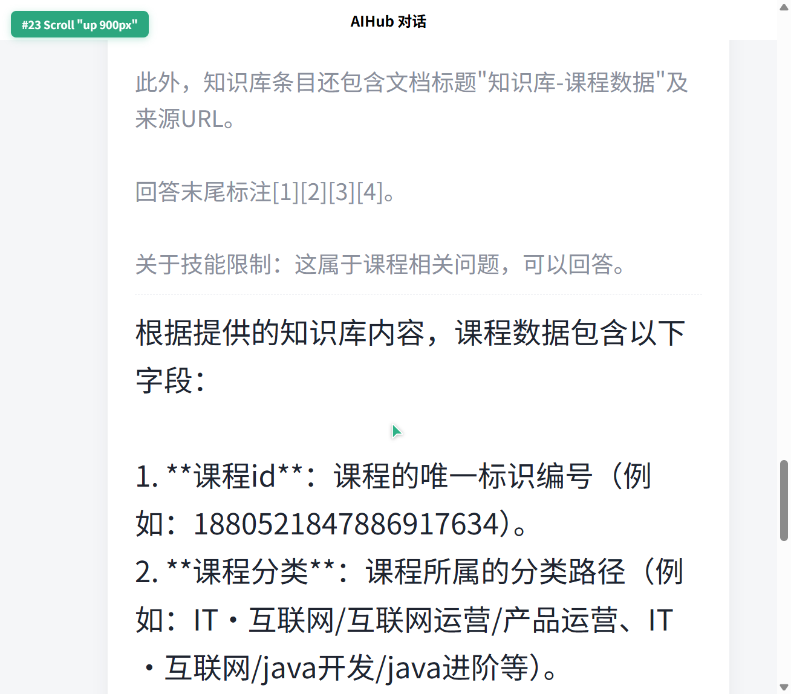

图 4-5　知识库模式问答（带编号引用）

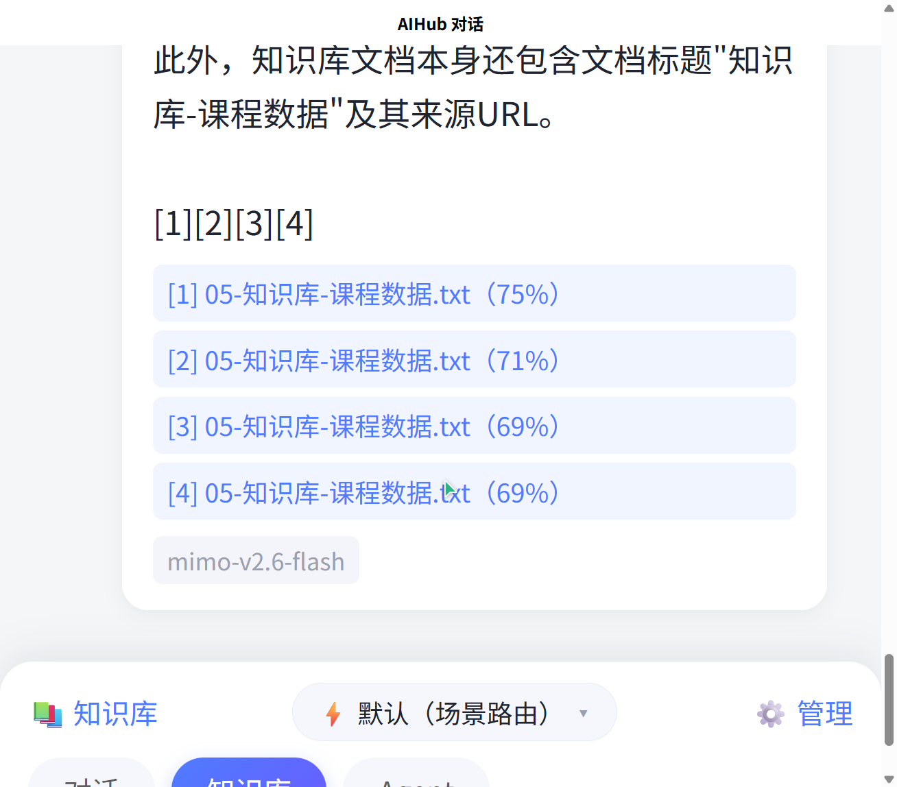

图 4-6　引用来源卡片（文档名 + 相似度）

### 4.4 Agent 自主任务执行

开启 Agent 策略的应用可接收多步任务：页面实时展示"思考→行动→观察"步骤时间线，任务产物（表格、图表、网页）完成后生成预览入口，全程可随时中断。如图 4-7 所示。

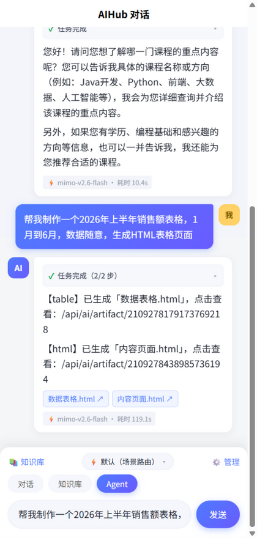

图 4-7　Agent 执行步骤时间线与产物入口

### 4.5 管理控制台

管理端面向租户管理员与应用配置者，提供工作台用量总览（调用量、Token 总量、平均耗时）、用户与角色权限管理、模型实例与场景路由管理、应用配置、知识库管理、用量统计与 API Key 管理等页面，配置保存后即时生效。如图 4-8 至图 4-12 所示。

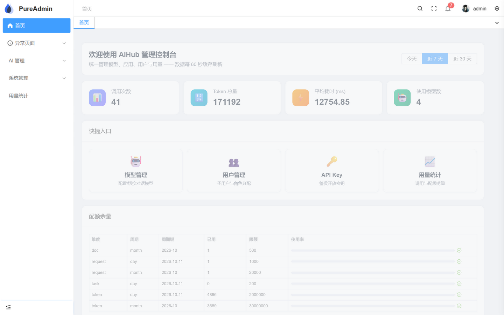

图 4-8　管理端工作台（用量总览卡片）


图 4-9　用户管理（本租户用户增删改与角色分配）

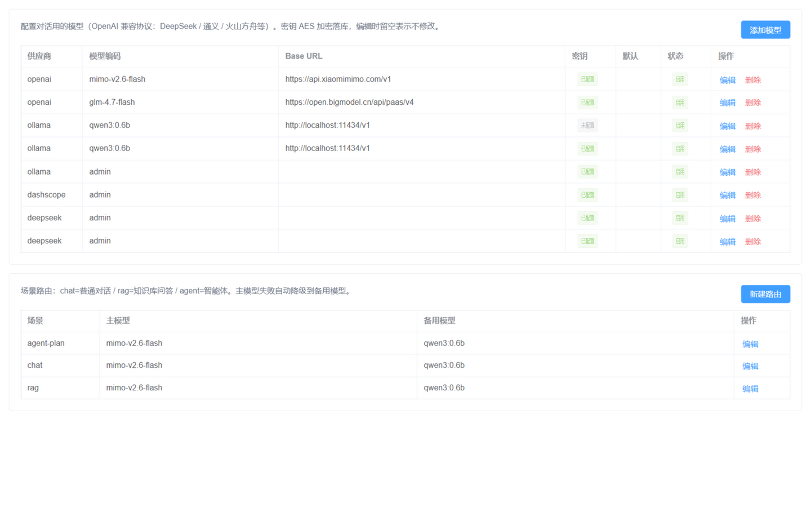

图 4-10　模型管理（供应商实例配置与密钥加密）

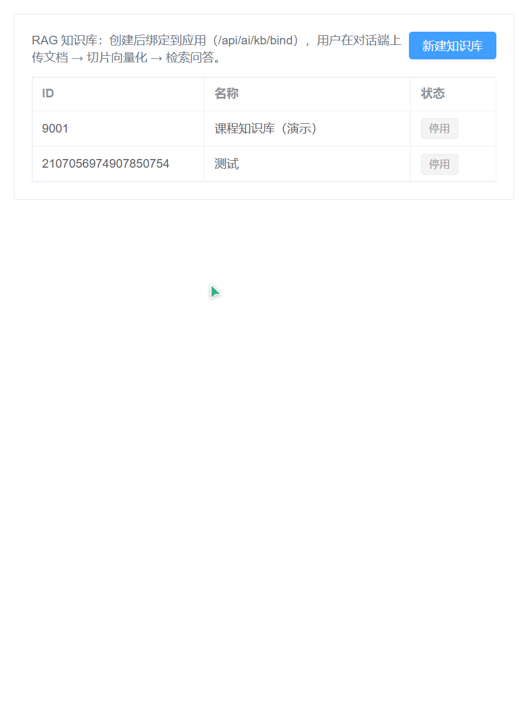

图 4-11　知识库管理（文档上传与入库进度）

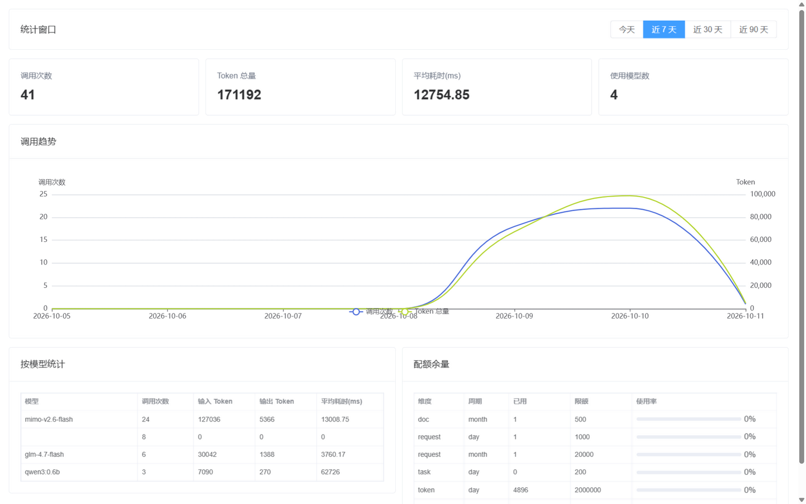

图 4-12　用量统计（多维度用量看板）

## 第五章 验证与测试

### 5.1 需求与实现映射

作品以需求规格说明书为基线开发，十二项功能需求与实现情况如表 5-1 所示。

表 5-1　功能需求实现情况映射表

| 需求编号 | 需求 | 优先级 | 实现情况 |
| --- | --- | --- | --- |
| FR-1 | 租户与身份（RBAC、API Key、跨租户拒绝） | P0 | 已实现 |
| FR-2 | 应用（助手）配置化编排与内置示例模板 | P0 | 已实现 |
| FR-3 | 模型管理（多供应商、加密存储、场景选模、降级） | P0 | 已实现 |
| FR-4 | 知识库与 RAG（四格式解析、异步入库、引用溯源） | P0 | 已实现 |
| FR-5 | 工具与 MCP（三类工具、双向集成、审计） | P1 | 已实现 |
| FR-6 | 会话与记忆（持久化、策略可配、用量记录） | P0 | 已实现 |
| FR-7 | Agent 编排（ReAct、三重预算、可中断、事件流） | P1 | 已实现 |
| FR-9 | 产物管理（落盘、预览、下载、租户隔离） | P1 | 已实现 |
| FR-10 | 安全护栏（防幻觉话术、规则可配置） | P1 | 已实现 |
| FR-11 | 配额、审计与可观测（四维配额、TraceId、看板） | P0/P1 | 已实现 |
| FR-12 | 开放 API 与前端（三通道流式、双端页面） | P0 | 已实现 |
| FR-8 | 提示词版本管理与灰度 | P1 | 规划中 |

### 5.2 多租户隔离验证

针对最高危的跨租户访问场景，验证路径覆盖三层：其一，单元测试层面验证各仓储查询条件中租户条件是否进入 SQL；其二，知识检索链路验证 A 租户检索不命中 B 租户文档——向量元数据强制过滤加出口逐条校验双保险；其三，网关层验证客户端伪造租户头会被强制剥离并覆盖为凭证解析结果。三层验证全部通过。

### 5.3 流式性能实测

使用探测脚本对"用户提问 → 网关转发 → 模型流式输出 → 前端逐帧渲染"全链路进行实测：经网关的一次完整问答共接收 103 个数据块，首帧（消息开始事件）于请求后 67 毫秒到达，思考过程帧与正文令牌帧按约 50 毫秒间隔逐帧递增直至响应结束，与直连 AI 服务的表现一致，验证了网关流式调优的有效性。浏览器端页内脚本复测同样获得 103 个逐帧到达的数据块，无跨帧缓冲。

### 5.4 可靠性与治理验证

模型降级：主模型配置为云端模型、备用模型为本地小模型的环境下，人为将主模型密钥置错，系统自动切换备用模型并在审计日志留痕。配额限流：按租户配置请求数与 Token 配额后，超限调用被拒绝并返回明确错误码。限流熔断：Sentinel 规则持久化于 Nacos，网关层限流生效，控制台可实时观测。配置热更新：在 Nacos 修改超时等参数，应用无需重启即生效。架构卡口：ArchUnit 依赖规则接入构建，违规依赖导致构建失败。

## 第六章 价值与展望

### 6.1 通用性与推广价值

本作品的核心价值在于通用性：平台不绑定任何垂直业务，任何需要大模型能力的场景都可通过配置接入。在**教育场景**，可为院校搭建课程知识助手，学生提问自动附带教材引用；在**企业知识管理场景**，可将产品手册、制度文档沉淀为知识库，新员工问答即问即答；在**政务与公共服务场景**，可通过开放 API 将合规的 AI 能力嵌入业务系统，配额与审计满足治理要求；对**开发者群体**，平台是现成的 AI 工程脚手架，避免每个项目重复建设。这与国家"人工智能+"行动中"推动人工智能与千行百业深度融合"的方向高度契合。

### 6.2 扩展性

平台在五个关键位置预留了接口驱动的扩展点：模型供应商、向量数据库、工具来源、Agent 策略与记忆存储均可替换而不改业务代码，分层依赖由 ArchUnit 在构建期强制守护。典型扩展路径举例：接入新的模型供应商只需新增一个实现类与一条配置；向量库从 Redis Stack 替换为专用向量数据库只需提供新的存储提供者实现；借助 MCP 生态，外部工具无需适配即可挂载，平台能力也可反向开放给第三方 AI 应用，形成双向生态。

### 6.3 后续迭代规划

下一阶段计划从三方面深化：一是补齐提示词版本管理与灰度发布能力（FR-8），支撑提示词的 A/B 实验；二是扩展多智能体协同编排，支持子智能体间的任务协商与结果聚合；三是完善端到端跨租户回归测试的真实库集成，并探索国产化环境适配，让平台在信创环境中同样可用。

# 团队分工

（待补充：成员姓名、分工与贡献占比）

# 参考文献

[1] 国务院. 新一代人工智能发展规划（国发〔2017〕35 号）[EB/OL]. (2017-07-20). https://www.gov.cn/zhengce/content/2017-07/20/content_5211996.htm.

[2] 国务院. 关于深入实施"人工智能+"行动的意见[EB/OL]. (2025-08-26). https://www.gov.cn/zhengce/content/202508/content_7037861.htm.

[3] 新华社. 我国人工智能企业数量超 6000 家[EB/OL]. (2026-01-21). https://www.gov.cn/lianbo/202601/content_7055635.htm.

[4] 中国政府网. 我国生成式人工智能用户超六亿人 成为全球人工智能专利最大拥有国[EB/OL]. (2026-03). https://www.gov.cn/yaowen/liebiao/202603/content_7060221.htm.

[5] VMware Tanzu. Spring Boot Reference Documentation[EB/OL]. https://docs.spring.io/spring-boot/index.html.

[6] Spring. Spring AI Reference Documentation[EB/OL]. https://docs.spring.io/spring-ai/reference/.

[7] VMware Tanzu. Spring Cloud Gateway Reference Documentation[EB/OL]. https://docs.spring.io/spring-cloud-gateway/reference/.

[8] Anthropic. Model Context Protocol Specification[EB/OL]. https://modelcontextprotocol.io/.

[9] DCloud. uni-app 官方文档[EB/OL]. https://uniapp.dcloud.net.cn/.

[10] 全国信息技术标准化技术委员会. GB/T 7714-2015 信息与文献 参考文献著录规则[S]. 北京: 中国标准出版社, 2015.
